# Software Supply Chain Security Demo

> See software supply chain security in action. We follow one small web application from its source code to a running service. We check the code, package it, find and fix its vulnerabilities, move to secure images to shrink the attack surface, then sign it, store it in a private registry and run it on Kubernetes. Everything runs on an environment that we build on AWS.


---

## Contents

* [Description](#description) - what this demo is, and why software supply chain security matters.
* [Strategy](#strategy) - the plan, the order of work, and the tools we use and why.
* [High-Level Steps and Actions](#high-level-steps-and-actions) - what we do, why we do it, and the business value of each action.
* [Infrastructure](#infrastructure) - what we build on AWS, and what each part is used for.
* [Deploying the Environment](#deploying-the-environment) - build the AWS environment, check it, and install Harbor.
* [Step-By-Step](#step-by-step) - the full guide, section by section.
* [References](#references) - links for further reading.

---

## Description

When you build an application, you do not write every line yourself. You use libraries that other people wrote. You start from a base image that other people made. You use tools to build, test and ship it. So your application is made of many parts, and they come from many places. Each part is a link in a chain.

Now ask a few questions. What if one link has a known security bug? Then your application has the same bug, and you may not know it. A known security bug is called a **vulnerability**, and it gets a public ID called a **CVE**. So how do you know if a CVE is in your own code, in your libraries, or in your base image? How serious is it? Should you put an image that has a known CVE into production? If not, how do you fix it? And how do you make sure you have fewer of them next time? A vulnerability does not go away by itself. Someone must find it and fix it, or attackers will use it.

Here is a simple way to see it. Every part you add to your application is a possible door for an attacker. More parts mean more doors. This is called the **attack surface**. Open-source software is a great thing, but it is not free of risk. So the best fix is not only to patch what you find. It is also to let in only what you really need, and to keep that small set up to date. Reducing the attack surface of the open-source software you use is the core of **secure open source**.

There are questions about trust as well. How fast can you find every application that uses a vulnerable link? How can you prove that the image running in production is the one you built, and that nobody changed it on the way? Together, all these questions are the topic of **software supply chain security**.

Here is a real example. In December 2021, a serious bug was found in Log4j, a very popular Java library. Companies all over the world had to ask: "Do we use it? Where?" Many needed days or weeks to answer. Teams that knew exactly what was inside their software could answer in hours.

**This repository is a hands-on demo of these ideas.** We take one small web application and follow it from source code to a running service on Kubernetes. On the way, we look at the security of every step.

In simple words, this is what we do:

1. We **check the code first**, before we build anything. We scan our own code and the libraries it uses. This is the "shift left" idea of DevSecOps.
2. We build the application as it is, with an old open-source image, and we scan it. In production, this work is normally done by a CI/CD pipeline, and this build would never happen. The pipeline would stop at the code check in step 1, because it finds critical issues and vulnerabilities. In this demo, we build anyway, on purpose and without a pipeline, to learn what the scanners find in an image.
3. We **fix** the code and the libraries, move to a newer open-source image, rebuild, and scan again. Some vulnerabilities will remain.
4. We switch to a **secure image** from `Chainguard`. Before we use it, we check who built it: we verify its signature and read its SBOM (a list of everything inside the image). Then we build and scan again.
5. We reduce the attack surface further with a **multi-stage build**. We build the application in the `Chainguard` development image (the `-dev` variant), and we run it in a minimal, distroless `Chainguard` image. We scan and compare all the results.
6. We run the final image as a standalone container.
7. We create SBOMs, store all the images in a private registry that scans images, sign the final image, and set rules that block images that are not safe.
8. We deploy the final image to a Kubernetes cluster and expose it to the public.

The application and the exercise come from a `chainguard` repository. It contains a small web application written in Go, and its libraries have known vulnerabilities. To understand the exercise in more detail, please check this repository: [chainguard-technical-challenge](https://github.com/maligin/chainguard-technical-challenge).

For the secure images, we use the container images from `Chainguard`. We compare them with the open-source images, to see what a secure base changes.

To do all this in a realistic setting, we also build an environment on AWS using a Terraform script. The Terraform script creates a private and a public network, one work machine (the `bastion`), and a small Kubernetes cluster with three nodes (one `master` node and two `worker` nodes) running `RKE2`. A load balancer is the public entry point. On the cluster, we install Harbor, an open-source private registry, and later we deploy the application. You can find more details in the [Infrastructure](#infrastructure) section.

> **Do not use in production.** This is a demo for learning. The environment is simple on purpose, and some settings (for example, skipping certificate checks for a private registry) are not safe for a real production system.

---

## Strategy

> **The idea in one paragraph**

In this demo, we want to understand and show the value of **secure images**, **multi-stage builds** and **distroless images**. We also want to understand the full idea of **software supply chain security**: where vulnerabilities can come from, how to find them, and how to reduce them. What we do is simple. We take a small Go application from the [Chainguard Technical Challenge repository](https://github.com/maligin/chainguard-technical-challenge). It is a web application, built with the Gin framework, and it only answers "Hello World!". We follow it from source code to a running service. We check the code first. Then we find out where the vulnerabilities come from, and we remove them in steps. We scan after every step. At the end, we prove that the final image can be trusted, and we run it on Kubernetes.

> **Why we start with the code: shift left**

Think of the path of an application as a line from left to right. We write the code, we build it, we package it into an image, we store the image, and we run it. The "left" is the start of this line.

If you find a security problem at the left, it is cheap to fix. You change a line of code or update a library, and you move on. If you find the same problem at the right, in production, it is expensive. The image is built, stored and running, and you must stop, fix, build, test and deploy again. So modern teams **shift left**. This means they check security as early as possible. This idea is part of **DevSecOps**.

This is why we start with the code, and not with an image.

> **What do we check in the code?**

We check two things.

1. **SAST** (Static Application Security Testing). A SAST tool reads our own source code and looks for risky patterns, such as weak settings or unsafe functions.
2. **SCA** (Software Composition Analysis). An SCA tool looks at the libraries we use and compares them with a database of known vulnerabilities.

Our application is very small, so there is almost no code of our own to check. Most of the risk is in the libraries. A SAST tool alone would miss this. This is why we use both kinds of check.

> **What happens in a real environment, and what we do here**

In the real world, nobody builds and checks images by hand. The team uses a CI/CD pipeline, built with tools such as Jenkins, GitLab CI or GitHub Actions.

It works like this. A developer writes code and pushes it to a Git repository, for example GitHub. The developer then makes a commit or opens a merge request. This starts the pipeline automatically (in most cases). The pipeline scans the code, checks it and tests it. If all the checks pass, it builds the container image from the source code. If a check fails, the pipeline stops.

In this demo, we do not use a pipeline. We do every step by hand. The reason is simple. This is a demo to show value and to learn, and we want to see every step and every result.

> **Where do vulnerabilities come from?**

A container image is made of layers, and each layer comes from a different place. For our Go application, a vulnerability can come from four places:

1. **Our own code.** The few lines we wrote. SAST checks this part.
2. **The libraries.** These are the libraries listed in the `go.mod` file, such as the Gin web framework. SCA checks this part.
3. **Go itself.** A Go program carries a part of the Go standard library inside its binary. If we build with an old Go version, we also carry the old bugs.
4. **The base image.** This is the Linux system inside the image, for example Debian. It has many packages, and each package can have bugs.

When we scan an image, the scanner tells us the type of each finding (operating system package, Go library, Go standard library). So even when we change several things at once, we can still see which part each change helped.

> **The images we build**

We build four images. They tell the story in order, and we change one thing at a time where we can.

| Image | Code and libraries | Go | Base image | Build style | What it shows |
|:---|:---|:---|:---|:---|:---|
| `hello-oss-single-v1` | Original | 1.18 (old) | Old open-source Go image | Single-stage | The starting point: problems from the code, the libraries, Go and the base image. |
| `hello-oss-single-v2` | Fixed | Current | Current open-source Go image | Single-stage | What fixing the code, the libraries and the image gives us. |
| `hello-cg-single` | Fixed | Current | secure `Chainguard` Go development image | Single-stage | What changes when only the base image changes. |
| `hello-cg-multi` | Fixed | Current | secure `Chainguard` Go development image to build, secure `Chainguard` minimal image to run | Multi-stage | What changes when only the build style changes, and the attack surface becomes as small as possible. |

Look at the pairs. Between `v2` and `cg-single`, the only change is the base image. Between `cg-single` and `cg-multi`, the only change is the build style. This is why the comparisons are fair.

> **Why a secure image?**

After we fix our code and update everything, some findings remain in the open-source image. We cannot remove them by updating, for example because no fix exists yet. So what can we do? We have three options.

- **Option 1: fix it ourselves.** We find the issue, fix it, and patch the image. This takes time and skill for every finding. It also moves our image away from the open-source version. This is called drift. We now own the patch, and we must keep it working.
- **Option 2: wait for the open-source community.** We wait until the community releases a fix. We do not control when this happens. Until then, we run with the vulnerability.
- **Option 3: use a secure image.** A secure image provider takes the same open-source software and builds it from source. It keeps the image as small as it can, and it fixes vulnerabilities without waiting for the community. We get the same open source with as few CVEs as possible. We have no patches to maintain, and no drift.

In this demo, we use option 3, with the images from `Chainguard`. We compare them with the open-source images to see the difference.

A secure single-stage image improves the CVE count, but some CVEs can remain, because it still carries the build tools. The next step is to remove them.

> **Why a multi-stage build?**

A single-stage image builds and runs the application in the same image. So the compiler and the build tools travel to production, and the application does not need them to run.

A **multi-stage** build splits the work. The first stage is a development image. It has the compiler and the tools, and it builds the application. The last stage is a minimal, distroless image. It has almost nothing in it. We copy only the finished application into it, and we change nothing else. The final image has no compiler, no shell and no package manager, so the attack surface is much smaller.

> **Check before you use: who built this image?**

Before we use an image that someone else built, we should ask three questions. Who built it? Was it changed on the way? What is inside it? The secure images are signed, and they publish an SBOM. So before every secure build, we pull the image, check the signature with Cosign, and read its SBOM. Only then do we build. We also pin the image by its digest, which is a fingerprint, so we build on exactly the image that we checked.

> **How we read the results**

* **Two scanners, not one.** Scanners use different databases and different rules, so they can give different numbers. We use two and compare them.
* **Reachability.** A scanner lists everything that is installed. It does not say if the program really uses the vulnerable code. We use a Go tool to check this, so we can tell which findings matter most.
* **Fixable or not.** For every finding, we ask: is there a fixed version? If yes, we update. If no, we cannot fix it by updating, and we must think about using a secure image or a smaller image.
* **Evidence.** We save the raw scan files, the date of each scan, and the version of each tool. Vulnerability data changes every day, so numbers can differ from one day to the next. Saved evidence lets us explain our numbers later.

> **The tools and why we use them**

| Tool | What it does | Why we use it |
|:---|:---|:---|
| **Terraform** | Creates the AWS environment from code. | The environment is repeatable. Anyone can create it again with a few commands. |
| **AWS** (VPC, EC2, load balancer) | Network, servers and the public entry point. | A realistic cloud setting with a public and a private network. |
| **RKE2** | An open-source Kubernetes distribution. | Simple to install, secure by default, and a good fit for a small cluster. |
| **kubectl** and **Helm** | Talk to Kubernetes, and install packaged applications. | The standard way to manage a cluster and to install Harbor. |
| **local-path-provisioner** | Gives the cluster simple disk storage on the nodes. | Harbor needs disk space to store images. |
| **Ingress controller** | One entry door for web traffic into the cluster. | Harbor and our application can share one public entry point. |
| **Harbor** | Open-source private container registry. | It stores images, scans them, shows SBOMs and signatures, and can enforce rules. |
| **Chainguard images** | Secure open-source container images, rebuilt often and published with a signature and an SBOM. | The same open source with as few CVEs as possible, without waiting for the community to ship fixes. |
| **gosec** | SAST tool for Go. Reads our code and warns about risky patterns. | Checks our own code before we build. |
| **govulncheck** | Official Go tool. Checks if vulnerable code is really used. | It separates findings that matter from findings that are only listed. |
| **Trivy** | Open-source scanner for code, images and Kubernetes files. | Checks libraries in the code, scans images, and checks our Kubernetes files. Harbor uses Trivy too, so we can compare. |
| **Grype** | Open-source vulnerability scanner. | The second scanner for images. It can also scan an SBOM without the image. |
| **Docker** | Builds and runs container images. | The most common tool for this work, and it works the same everywhere. |
| **Hadolint** | Checks a Dockerfile for common mistakes. | Catches bad habits before we build. |
| **Syft** | Creates an SBOM from an image. | An SBOM tells us exactly what is inside an image. |
| **Cosign** | Signs and verifies images and SBOMs. | We use it to check the signature and the SBOM of the secure images before we use them, and to sign our own final image. |
| **jq** | Reads and filters JSON files. | Scan results are JSON, and jq helps us count and compare them. |

---

---

## High-Level Steps and Actions

This is a short overview of what we do and why we do it. The detailed commands are in the [Step-By-Step](#step-by-step) section.

**1. Build the environment:** We use Terraform to create a network, a work machine, a Kubernetes cluster and a registry. | *Why:* Code-based environments are repeatable, easy to review and quick to create again. In this demo, we need a realistic place to build, store and run the images, and we want anyone to be able to repeat it.

**2. Check our code and our libraries (shift left):** Before we build anything, we scan our own code (SAST) and the libraries it uses (SCA). | *Why:* The earlier you find a problem, the cheaper it is to fix. A fix in a source file takes minutes. The same fix in production takes days. In this demo, we need to know which vulnerabilities and flaws come from our own code and libraries, so we can follow them through the flow and see later which ones are still there.

**3. Build the image as it is, and scan it:** We build the unfixed application in a single-stage image with an old open-source base image, and we scan it with two scanners. | *Why:* Scanning an image shows you what is inside it and which known vulnerabilities it carries, including the ones that come from the base image and the libraries. The scan turns risk into numbers (CVEs by severity), and these numbers become the baseline that lets you prove later that things got better. In this demo, we use code that we already know has issues, to show the idea and to improve understanding.

**4. Understand which findings matter:** We group the findings by source, compare the two scanners, check which findings have a fix, and check which vulnerable code the program really uses. | *Why:* A long list of findings is not a plan. Teams need to know where to start, so they do not waste time on alerts that do not matter. In this demo, we want to show where vulnerabilities come from (code, libraries, Go, base image), so we can see later what each step helped.

**5. Fix the code, the libraries and the image, then scan again:** We update the libraries, fix a code warning, move to a current Go version and a current open-source image, and build again. | *Why:* Updating is usually the cheapest fix, and one update can remove many findings at once. In this demo, we want to see how far updating can go. Some findings will remain, because no fix exists for them yet, and this leads to the next step.

**6. Check the secure image, then use it (single-stage):** We pull the secure image, verify its signature, read its SBOM, and pin it by digest. Then we build, scan and compare. | *Why:* When a finding has no fix, you can fix it yourself, wait for the open-source community, or use a secure image that is built from the same open source with as few CVEs as possible. You should also never trust an image only because of its name. In this demo, we want to show the value of a secure image, and we check who built it and what is inside before we use it.

**7. Reduce the attack surface with a multi-stage build:** We build the application in a development image and run it in a minimal, distroless image. We check this image the same way, then scan and compare everything. | *Why:* The compiler and the build tools are not needed to run the application. Every extra tool is a possible vulnerability and a possible tool for an attacker. In this demo, we want to show how much smaller the attack surface becomes when only the finished application is left in the final image.

**8. Run the final image with safe settings:** We run it as a standalone container, with a non-root user, a read-only file system and no extra Linux powers. | *Why:* Even a good image can have a bug that nobody knows yet, so we limit what an attacker can do. This is the "least privilege" idea. In this demo, we want to prove that the final image runs correctly with these tight settings.

**9. Create SBOMs:** We create a Software Bill of Materials (SBOM) for each image. It is a list of every package, library and tool inside the image, with their versions. | *Why:* You cannot protect what you cannot see. With the list, you can match every item to a vulnerability database, such as the NVD, which publishes each new CVE with its severity and, when available, the fix. When the next big vulnerability is announced, you can answer "are we affected?" in minutes. In this demo, we want to show how an SBOM makes this possible, and that it can be scanned again later without the image.

**10. Store the images in a private registry and scan again:** We push the images to Harbor, which scans them and keeps the results in one place. We compare Harbor's results with our own scans. | *Why:* The registry is the gate between building and running, so it is the best place to check images and to enforce rules. In this demo, we want to show a central view of risk, and a second, independent scan to compare with our own.

**11. Sign the final image and enforce rules:** We sign the final image and its SBOM with Cosign, verify them, and set rules in the registry: no unsigned images, and no images with serious vulnerabilities. | *Why:* A signature shows who made the image and that nobody changed it, but it does not say the image is safe. So we combine it with the vulnerability check. In this demo, we want to show trust that you can prove: an image can run only if we know who made it and it passed our scan.

**12. Deploy to Kubernetes and expose to the public:** We deploy the signed image from Harbor with safe settings, check the Kubernetes files for mistakes, and make the application reachable from the internet. | *Why:* The same checks must work in a real cluster, and a new application should follow the same safe path from day one. In this demo, we want to prove the full path, from source code to a running service.

---

## Infrastructure

To follow the application from source code to a running service, we need three things: a place to build and check images, a place to run them, and a place to keep them. So we build a small environment on AWS.

To make this easy, this repository includes a Terraform script. You can use it to create the environment, with the components and the architecture described in this section. The script is a copy of the one in [this repository](https://github.com/tahershaker/Kubernetes-Hands-On-Demo-On-AWS/tree/main/01-Provision), with some edits that make the step-by-step work easier to start. We added a cloud-init script to the EC2 instances, which installs and configures an RKE2 cluster automatically. We also added a setup to the bastion node, which installs `kubectl` and `helm` on it.

The Terraform script has a variables file and a `tfvars.example` file, so you can customize it if you want. In this demo, we use the default values. If you want to customize it, see [the customization section of the main repository](https://github.com/tahershaker/Kubernetes-Hands-On-Demo-On-AWS/tree/main/01-Provision#customization).

At a high level, the script creates:

* **One VPC with two subnets, one public and one private.** The public subnet holds the bastion node, the network load balancer and the NAT gateway. It is connected to the internet gateway, so it has direct access to the internet. The private subnet holds the three nodes of the RKE2 Kubernetes cluster that we use in this demo.
* **Routing, security rules and load balancing.** The script also sets all of these.
* **An SSH key.** The script creates it and saves it in the same folder as the script, so you can use it to connect to the bastion node. The same key is also in the home directory of the bastion node, so you can connect from there to the other instances.

The diagram below shows the high-level architecture of this environment.

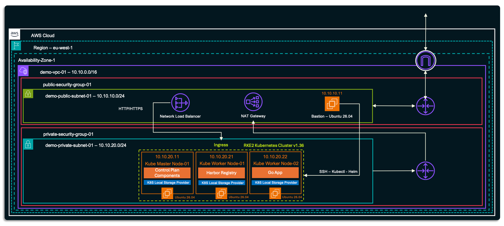

> **What each part is used for**

| Part | What it is used for |
|:---|:---|
| **Bastion** | The only machine with SSH access from the internet. It is also our work desk. We check the code, build container images, run the scanners, create SBOMs, sign images, and run `kubectl` and Helm from here. A Linux machine with a fixed setup makes our work repeatable. |
| **Kubernetes master node** | The control plane of the cluster. |
| **Kubernetes worker nodes (2)** | They run the workloads: Harbor and, later, our application. |
| **Harbor** | Deployed on Kubernetes with Helm. It is our private registry. It stores our images, scans them for vulnerabilities, shows SBOMs and signatures, and can block images that break our rules. |
| **Local storage provisioner** | Gives the cluster disk space from the nodes. Harbor needs it to store images and its database. |
| **Ingress controller** | One entry door for web traffic into the cluster. It sends traffic to Harbor or to our application, based on the name in the request. |
| **Network Load Balancer** | The public entry point. It receives traffic on ports 80 and 443 and sends it to the nodes. |
| **NAT gateway** | Lets the private nodes reach the internet (for example, to download images), without being reachable from the internet. |

The traffic flow is simple. A request comes from the internet to the load balancer. The load balancer sends it to the ingress controller on a node. The ingress controller sends it to Harbor or to the application.

> **Components created by Terraform**

| Component | Count | Details |
|:---|:---|:---|
| VPC | 1 | `10.10.0.0/16` |
| Subnets | 2 | Public `10.10.10.0/24` and private `10.10.20.0/24`, in one availability zone |
| Internet gateway | 1 | Internet access for the public subnet |
| NAT gateway | 1 | Outbound-only internet access for the private subnet |
| Elastic IPs | 3 | For the NAT gateway, the load balancer and the bastion |
| Route tables | 2 | One for each subnet |
| Security groups | 2 | One for the public subnet and one for the private subnet |
| Network Load Balancer | 1 | Internet-facing, with listeners on ports 80 and 443 |
| EC2 instances | 4 | 1 bastion (`t3.medium`), 1 master (`t3.medium`), 2 workers (`t3.xlarge`). All nodes have 100 GB disks. |
| SSH key pair | 1 | Created by Terraform. You do not need to bring your own key. |
| RKE2 | 3 nodes | Installed and configured automatically on the master and the two workers |

These are the default values of the Terraform script.

---

## Deploying the Environment

Before we start the software supply chain security demo and the step-by-step work, we deploy the environment that we described in the previous section. In this section, we deploy the AWS environment with the Terraform script, check that everything is up, and install Harbor on the Kubernetes cluster.

> **Note:** The deployment uses the **default values** of the Terraform script. If you want to change something, for example the region or the size of the nodes, see the [customization guide](https://github.com/tahershaker/Kubernetes-Hands-On-Demo-On-AWS/tree/main/01-Provision#customization).

> **Prerequisites**

To use the Terraform script, you need the following tools installed and configured on your laptop:

* **Terraform**, version 1.9 or newer. Check it with `terraform -v`.
* **The AWS CLI**, configured with credentials that can create VPCs, EC2 instances and load balancers.
* **Git**.
* **Outbound internet access**, so Terraform can download its providers.

Steps 1 to 5 run on your laptop. Steps 6 to 12 run on the bastion.

## Step 1: Clone this repository

We start by getting the code. The Terraform files are in the `Terraform/` folder.

```bash
git clone https://github.com/tahershaker/Software-Supply-Chain-Security-Demo.git
cd Software-Supply-Chain-Security-Demo/Terraform
```

## Step 2: Initialize, validate, and review the Terraform plan

`init` downloads the providers that Terraform needs. `validate` checks the files for errors. It does not touch AWS. The plan shows what Terraform will create, before it creates anything. It is worth reading the output.

```bash
terraform init
terraform validate
terraform plan -out=tfplan
```

## Step 3: Apply

This step creates everything in your AWS account. It can take several minutes.

```bash
terraform apply tfplan
```

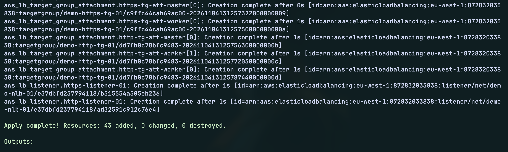

## Step 4: Save the outputs

When the apply ends, Terraform prints the bastion address, the load balancer address, the SSH key name and the IP address of every node. Save them. You can print them again at any time:

```bash
terraform output
```

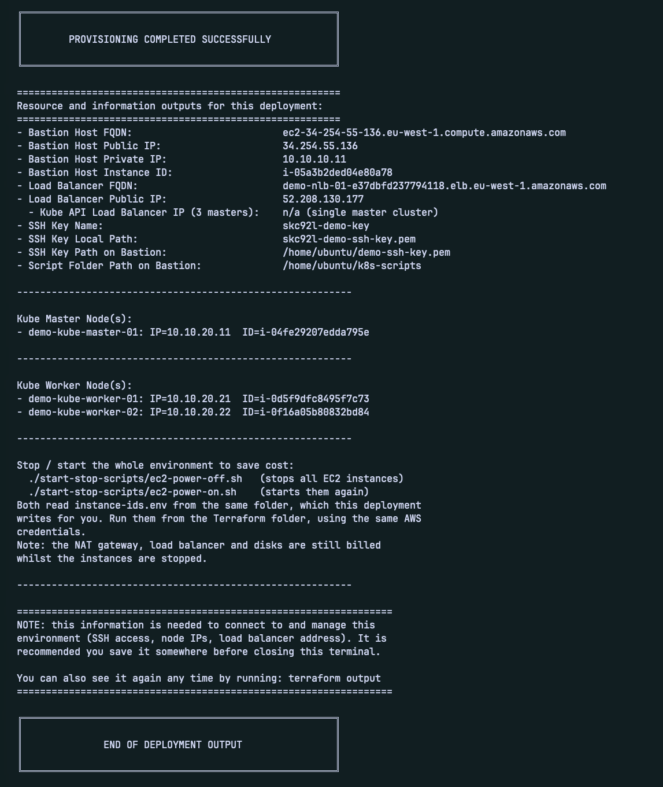

## Step 5: Connect to the bastion

Terraform saved the SSH key in the `Terraform/` folder. The file name starts with a random prefix, so use the name shown in the outputs. The user name is `ubuntu`. Before you SSH, make sure that the EC2 instances are in a running state using the AWS console.

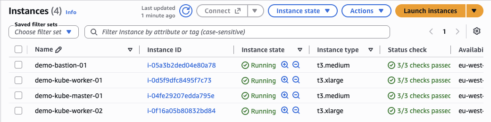

```bash
ssh -i <path-to-ssh-key> ubuntu@<bastion-public-ip>
```

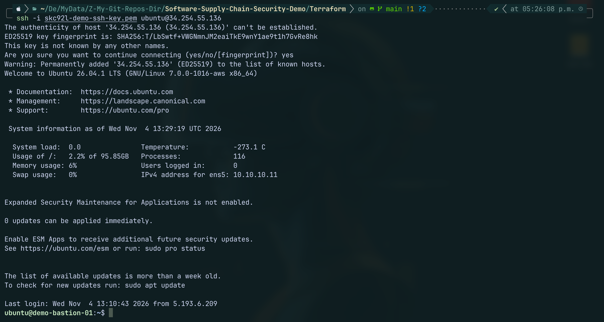

## Step 6: Wait for the first setup to finish

When the instances start, a cloud-init script runs on each of them. On the bastion, it installs `kubectl` and Helm. This takes a few minutes. This command waits until it is done.

```bash
cloud-init status --wait
# If status is failed, you can use the below commands to check failuer
# cloud-init status --long
# sudo tail -60 /var/log/cloud-init-output.log
```

> Expect: status: done

## Step 7: Give the bastion access to the cluster

The cluster credentials are on the master node. We copy them to the bastion, so we can run `kubectl` and Helm from here. The file points to `127.0.0.1`, which is only correct on the master. So we change it to the private IP of the master.

```bash
mkdir -p ~/.kube
scp -i ~/demo-ssh-key.pem -o StrictHostKeyChecking=accept-new ubuntu@demo-kube-master-01:/etc/rancher/rke2/rke2.yaml ~/.kube/config
sed -i 's/127.0.0.1/10.10.20.11/' ~/.kube/config
```

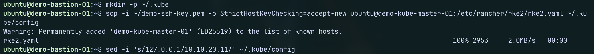

## Step 8: Check the cluster

All three nodes must be `Ready`. The nodes can need a few more minutes after the instances start, so run the command again if you see fewer than three.

```bash
kubectl get nodes -o wide
```

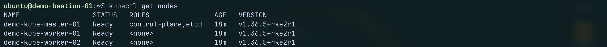

Then check that the system pods are running. All pods should be `Running` or `Completed`.

```bash
kubectl get pods -A
```

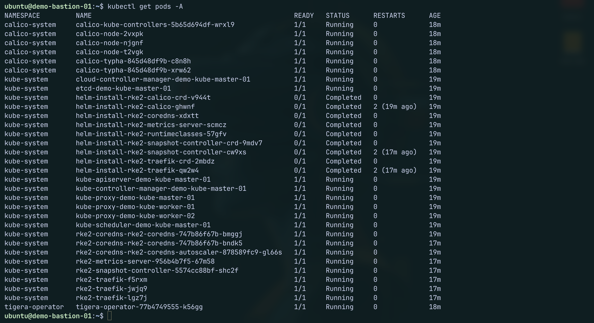

## Step 10: Install the local storage provisioner

Harbor needs disk space for its images and its database. RKE2 does not give us a storage class by default. So we install a small component that creates disk space on a node when an application asks for it. Then we make it the default.

```bash
kubectl apply -f https://raw.githubusercontent.com/rancher/local-path-provisioner/master/deploy/local-path-storage.yaml
kubectl patch storageclass local-path -p '{"metadata":{"annotations":{"storageclass.kubernetes.io/is-default-class":"true"}}}'
```

The storage class `local-path` should now be marked `(default)`:

```bash
kubectl get storageclass
```

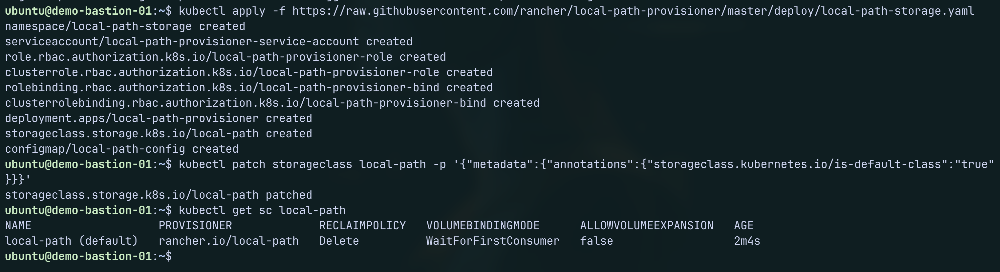

> The data lives on the disk of the node. If the node is replaced, the data is lost. This is fine for a demo.

## Step 11: Install Harbor with Helm

Helm is the package manager of Kubernetes. A Helm chart is a ready-made package. The Harbor team publishes a chart, so we add their repository and install from it.

First, we set the values that we need as variables, so we can copy and paste the commands. There are three:

* `LB_IP` is the public IP address of the network load balancer. You can find it in the Terraform outputs (see Step 5).
* `HARBOR_PASSWORD` is the admin password. Choose a strong one, and do not keep the default, because Harbor will be reachable from the internet. Do not use a comma in it, because Helm treats a comma as a separator.
* `HARBOR_FQDN` is the host name of Harbor. We build it with `nip.io`, a free public DNS service. It turns `harbor.<ip>.nip.io` into `<ip>`, so we do not need our own DNS record.

```bash
export LB_IP="<nlb-elastic-ip>"
export HARBOR_PASSWORD='<choose-a-strong-password>'
export HARBOR_FQDN="harbor.${LB_IP}.nip.io"
```

Variables are lost when you close the terminal. If you open a new session, run these three lines again. We use the same variables in the next sections.

Now we add the Harbor repository and install the chart in its own namespace. The settings do the following:

* **Ingress:** Harbor is exposed through the ingress controller of RKE2, which is Traefik. The load balancer sends ports 80 and 443 to the nodes, and Traefik sends the traffic to Harbor.
* **TLS:** Harbor creates its own self-signed certificate. A browser will show a warning. This is expected in this demo.
* **External URL:** This is the address that Harbor tells clients to use, so it must match the host name.

```bash
helm repo add harbor https://helm.goharbor.io
helm repo update

helm install harbor harbor/harbor \
  --namespace harbor --create-namespace \
  --set expose.type=ingress \
  --set expose.ingress.className=traefik \
  --set expose.ingress.hosts.core=${HARBOR_FQDN} \
  --set expose.tls.enabled=true \
  --set expose.tls.certSource=auto \
  --set externalURL=https://${HARBOR_FQDN} \
  --set harborAdminPassword="${HARBOR_PASSWORD}"
```

Harbor has several parts (core, database, registry, job service, Trivy scanner and others), and each is a pod. It takes a few minutes to start. Wait until all pods are `Running`:

```bash
kubectl -n harbor get pods
```

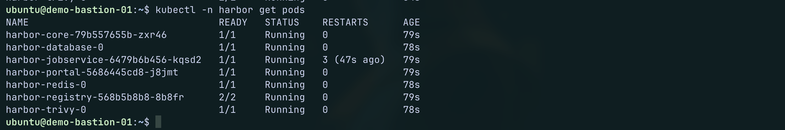

When they are ready, open `https://<your-harbor-fqdn>` in your browser, accept the certificate warning, and log in with the user `admin` and your password.

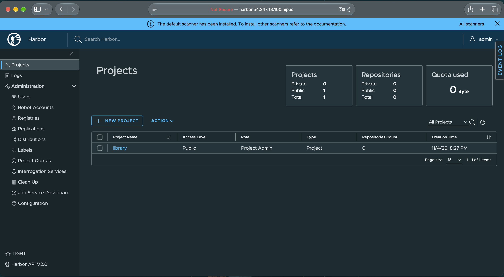

## Stop and start the environment

If you are not using the environment and do not want to destroy it, you can stop the instances to save cost. You have two options:

* Stop the instances from the AWS console.
* Use the start and stop scripts in the `start-stop-scripts/` folder of this repository. The Terraform script already created a file with the values that the scripts need and saved it in this folder, next to the scripts. The scripts read the values from this file, so you do not need to enter anything. The stop script stops all the instances for you. When you come back and want to continue, run the start script.

Run the scripts from your laptop, with the same AWS credentials that you used for Terraform.

> **Note:** Stopping the instances saves the cost of the servers only. The NAT gateway, the load balancer and the Elastic IPs keep costing money every hour, even when the instances are stopped. If you will not use the environment for a long time, destroy it (see the last section) and create it again later.

```bash
cd start-stop-scripts
chmod +x *.sh
.ec2-power-off.sh   # stop all instances
.ec2-power-on.sh    # start them again
```

## Clean up

When you are done with the demo and want to delete everything, run the Terraform destroy command from the `Terraform/` folder on your laptop:

```bash
terraform destroy
```

Terraform shows what it will delete and asks you to confirm. Type `yes`. This removes the whole environment from AWS: the instances, the network, the load balancer and the NAT gateway. Everything inside the cluster is deleted too, including Harbor and all the images in it. After it finishes, check the AWS console to make sure that nothing is left, so that you do not pay for a forgotten resource.

---

> ###################################
>
> SSCS DEMO START HERE - STEP-BY-STEP
>
> ###################################

---

## SSCS Demo Activity - Step-By-Step

Now that the environment is up and running, we can start the demo. This is the main part of this guide. Here, we go through the activity that was described at the beginning. We do it in stages, and each stage focuses on one point, as explained before. Each stage has the steps that you need to complete its activity. In each step, we explain what we do and why we do it. We also look at the result, and think about what it means before we move to the next step.

> Note: Unless a step says otherwise, **run all commands on the bastion**.

---

## Section 1: Prepare the bastion and the application

Before we touch the application, we need our tools, our code and a clear place to keep our work. We do this once.

### Step 1.1: Install the tools

We need Docker to build images, and open-source tools for scanning, SBOMs and signing: Grype, Trivy, Syft and Cosign. We also install `jq` to read JSON files. The code scanners (gosec and govulncheck) run inside a Go container, so we do not install them.

```bash
sudo apt-get update && sudo apt-get install -y docker.io jq
sudo usermod -aG docker $USER && newgrp docker

curl -sSfL https://raw.githubusercontent.com/anchore/grype/main/install.sh | sudo sh -s -- -b /usr/local/bin
curl -sSfL https://raw.githubusercontent.com/anchore/syft/main/install.sh | sudo sh -s -- -b /usr/local/bin
curl -sfL https://raw.githubusercontent.com/aquasecurity/trivy/main/contrib/install.sh | sudo sh -s -- -b /usr/local/bin
curl -sSfL -o cosign https://github.com/sigstore/cosign/releases/latest/download/cosign-linux-amd64 && sudo install cosign /usr/local/bin/cosign && rm cosign

docker --version && grype --version && syft --version && trivy --version && cosign version | grep GitVersion
```

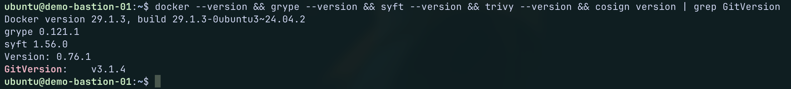

### Step 1.2: Get the code

We create a working folder called `demo`. Then we clone the public exercise repository, which has the Go application, and we copy the application into the `app` folder. This is our original copy, and we do not change it. We need it for the "before" results.

```bash
mkdir demo && cd demo
git clone https://github.com/maligin/chainguard-technical-challenge.git challenge-repo
cp -r challenge-repo/go app
mkdir -p Dockerfiles reports/code Manifests Images
```

From now on, we work in the folder `~/demo`.

### Step 1.3: Look at the application

Before we check anything, let us see what we have.

```bash
cat app/main.go
cat app/go.mod
```

The application is very small. It starts a web server with the Gin framework and answers `Hello World!` on port 8080. Now look at `go.mod`. It lists the libraries the application uses. There is one **direct** dependency, which is Gin (version 1.8.1). All the others are marked `// indirect`. They are libraries that Gin needs, and Gin needs libraries that need other libraries. Look at the versions. Many are from 2021 and 2022. Software that is this old often has known bugs. This is where we expect to find problems.

### Step 1.4: Create a scan helper

We will scan several images in this guide. Every scan should follow the same rules, so the results can be compared. So we write one small script and use it every time. It runs both scanners, saves the raw results, and prints a count by severity.

```bash
cat > scan.sh <<'EOF'
#!/usr/bin/env bash

set -euo pipefail
IMAGE="$1"; NAME="$2"; OUT="reports/$NAME"
mkdir -p "$OUT"

# Scan with both scanners and keep the raw JSON and a readable table
grype "$IMAGE" -o json  > "$OUT/grype.json"
grype "$IMAGE" -o table > "$OUT/grype.txt"
trivy image --quiet --format json --output "$OUT/trivy.json" "$IMAGE"
trivy image --quiet "$IMAGE" > "$OUT/trivy.txt"

# Print the number of findings for each severity
echo "== Grype: $NAME =="
jq -r '[.matches[].vulnerability.severity] | group_by(.) | map("\(.[0]): \(length)") | .[]' "$OUT/grype.json"
echo ""
echo "--------------------------"
echo ""
echo "== Trivy: $NAME =="
jq -r '[.Results[]?.Vulnerabilities[]?.Severity] | group_by(.) | map("\(.[0]): \(length)") | .[]' "$OUT/trivy.json"
echo ""
echo "--------------------------"
EOF
chmod +x scan.sh
```

If a scanner finds nothing for a severity, that severity does not appear in the count. If nothing is printed under a scanner, it found nothing.

---

## Section 2: Check the code (shift left)

We have the application. The normal next step would be to build it. But let us ask a better question first: **is this code good enough to be built?** In a DevSecOps pipeline, security checks run on every code change, and a failed check stops the build. The reason is simple. A problem found in the code is cheap to fix. A problem found in a running image is not. So we do the same checks by hand, before we build anything.

We run three checks. One is SAST, which reads our own code. Two are SCA, which look at the libraries.

### Step 2.1: Check our own code with SAST

We use `gosec`, a SAST tool for Go. It reads the source code and looks for risky patterns, for example weak cryptography, hard-coded passwords or unsafe use of the network. We run it inside a Go container.

```bash
docker run --rm --user "$(id -u):$(id -g)" -e HOME=/tmp -v "$PWD/app:/src" -w /src golang:latest \
  sh -c 'go install github.com/securego/gosec/v2/cmd/gosec@latest && gosec ./...' \
  | tee reports/code/gosec-before.txt
```

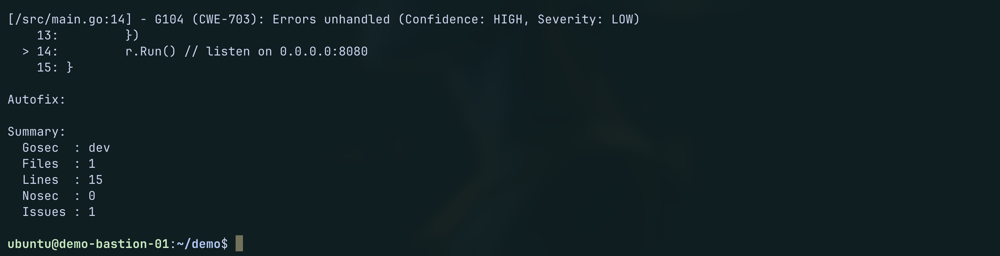

Read the summary at the end. It shows the number of files, lines and issues. In our case, gosec checked 1 file with 15 lines, and it found 1 issue. The issue has a rule number (`G104`), a severity (`LOW`), and the file and line (`main.go`, line 14). It points to `r.Run()`, the line that starts the web server. This function can return an error, for example if the port is already in use, and our code does not check it. This is a code quality problem and not a security hole, which is why the severity is low. For an application of 15 lines, one small finding like this is normal. But do not stop here. SAST looks only at our own code. It does not look at the libraries, and our application uses many.

### Step 2.2: Check the libraries with govulncheck

This is the first SCA check. `govulncheck` is the official Go tool for known vulnerabilities. It does something that many scanners do not: it checks if our code really calls the vulnerable function. This is called reachability.

```bash
docker run --rm --user "$(id -u):$(id -g)" -e HOME=/tmp -v "$PWD/app:/src" -w /src golang:latest \
  sh -c 'go install golang.org/x/vuln/cmd/govulncheck@latest && govulncheck ./...' \
  | tee reports/code/govulncheck-before.txt
```

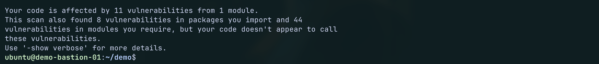

Read the output. The first part lists the vulnerabilities that our code really calls. These are the real risk. Our scan found 11 of them. Each entry has an ID (like `GO-2026-6617`), a short title, the library, the installed version, and the version that fixes it. All 11 come from one library, `golang.org/x/net`, and we use a version from 2021. Under each entry, there is a list of traces. They show how our code reaches the problem: `main.go` calls Gin, and Gin calls the HTTP/2 code in this library. The traces are long, so the full output is saved in the file [govulncheck-before.txt](/Scan-Outputs/code/govulncheck-before.txt).

The summary at the end is the most important part. It says that our code is affected by 11 vulnerabilities from 1 module. It also says that the scan found 8 more vulnerabilities in packages that we import, and 44 in modules that we require, but our code does not appear to call them. These have a lower priority. A scanner that only lists what is installed would show all 63. `govulncheck` shows which 11 matter most.

The fix is clear. The newest fix for these 11 is in version `v0.60.0` of `golang.org/x/net`, so one update to this version, or a newer one, removes all of them.

### Step 2.3: Check the libraries with Trivy

The second SCA check is Trivy. It reads `go.mod` and `go.sum`, and lists every library that has a known vulnerability, whether our code calls it or not. A second tool gives a second opinion.

```bash
trivy fs app/ | tee reports/code/trivy-fs-before.txt
```

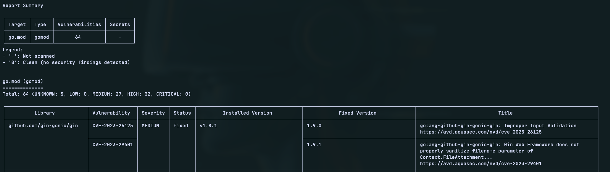

Trivy found **64 vulnerabilities** in `go.mod`: 32 HIGH, 27 MEDIUM and 5 UNKNOWN, with no CRITICAL or LOW. The full output is saved in `Scan-Outputs/trivy-fs-before.txt`.

To read the table, look at four columns for each row: the library, the severity, the installed version and the fixed version. Here, all 64 findings sit in six libraries, and every one has a fixed version available. Most come from the old `golang.org/x/*` libraries, mainly `x/crypto` and `x/net`, so updating those libraries removes most of the findings. The full output table is saved in the file [trivy-fs-before,txt](/Scan-Outputs/code/trivy-fs-before.txt)

Trivy and govulncheck find almost the same vulnerable versions: 64 for Trivy and 63 for govulncheck. The difference is what they do next. Trivy stops at the list. govulncheck checks whether the code calls the vulnerable function, and only **11 of its 63** are reachable (the other 8 are in imported packages and 44 in required modules that the code does not call). So Trivy tells us what is installed, and govulncheck tells us what to fix first.

### Step 2.4: Summary and thoughts

**Summary:** The code scan found a small problem in our own code. The library scans found many more problems in the libraries we depend on. We have not built any image yet, so this is only the first part of the picture.

| Check | Tool | What it looks at | Result |
|:---|:---|:---|:---|
| SAST | gosec | Our own code | `<N>` issue(s) (G104: unhandled error) |
| SCA (reachability) | govulncheck | Libraries that our code calls | 63 found, **11 reachable**, all in `golang.org/x/net` |
| SCA (all libraries) | Trivy | Every library in `go.mod` | **64 found**: 32 HIGH, 27 MEDIUM, 5 UNKNOWN, 0 CRITICAL |

**What we found**

- Our own code has only a small issue, and the fix is one line.
- The libraries carry most of the risk. Both SCA tools agree that the libraries are old and vulnerable (64 for Trivy, 63 for govulncheck).
- A fixed version exists for every one of them. Nothing here is waiting for a patch.

**Is it fixable, and at what cost?**

We need to fix these findings. The goal is that our application does not ship an exploitable weakness, and that it meets security best practice. So for each issue, we need to think about the fix and what it costs us.

> **Issue 1: Unhandled error in our code (gosec G104)**
- **Fix:** Check the error that `r.Run()` returns, and log it.
- **Cost:** Low. It is one line, and it is our own code.

> **Issue 2: The 11 reachable vulnerabilities in `golang.org/x/net` (govulncheck)**
- **Fix:** Update `golang.org/x/net` to v0.60.0 or newer.
- **Cost:** Low to medium. The change is small, but the old version is from 2021, so the jump is big. We must rebuild and test the app after it.

> **Issue 3: The other 53 findings in `go.mod` (Trivy)**
- **Fix:** Update the libraries to the fixed versions: `gin` 1.9.1, `golang.org/x/crypto` (latest), `golang.org/x/net` 0.62.0, `golang.org/x/sys` 0.44.0, `golang.org/x/text` 0.41.0 and `google.golang.org/protobuf` 1.33.0. One `go get -u ./...` followed by `go mod tidy` does this.
- **Cost:** Low to medium, for the same reason: rebuild and test. The bigger cost is that this work never ends. New CVEs appear every month, so we must repeat it.

In a real pipeline, the story would stop here. The pipeline would fail, and nobody would build the image until the problems are fixed. In this demo, we continue on purpose, only to learn. We will **not fix yet**. We want to see the full picture first, then fix everything in one go in Step 5.

---

## Section 3: Build the image as it is (open-source, old version, single-stage)

We build the unfixed application with an open-source image. We use an old version on purpose: Go 1.18, the version named in `go.mod`. An old image carries old problems from the base image and from Go itself. We want to see them.

We use a **single-stage** build. This is the simplest way to package an application: one Dockerfile with one `FROM` line. We start from the official Go image, copy our code in, build it, and run it.

> Note: Run every command in this section from the `~/demo` folder. The Dockerfile path and the build context both depend on it.

### Step 3.1: Write the Dockerfile

```bash
cat > Dockerfiles/Dockerfile.1-oss-single <<'EOF'
FROM golang:1.18
WORKDIR /app
COPY app/ .
RUN CGO_ENABLED=0 go build -o hello-server .
CMD ["./hello-server"]
EOF
```

`CGO_ENABLED=0` makes Go build a static binary. We use the same build command in all four images, so the comparison between them is fair.

### Step 3.2: Build and test

We build the image and run it once to check that the application works and answers `Hello World!`.

**Build the image**

```bash
docker build -f Dockerfiles/Dockerfile.1-oss-single -t hello-oss-single-v1:1.0 .
```

**Run the image**

```bash
docker run -d --name test-v1 -p 8080:8080 hello-oss-single-v1:1.0
```

**Check that it returns Hello World!**

```bash
curl -s http://localhost:8080; echo
```

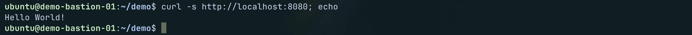

You should see `Hello World!`.

**Delete the container**

```bash
docker rm -f test-v1
```

---

## Section 4: Scan the image and understand the findings

We have an image built from the unfixed code on an old base. Does an image scan find the same things as the code check? Let us find out.

### Step 4.1: Scan the image

A reminder of two words. A **CVE** (Common Vulnerabilities and Exposures) is a public ID, like `CVE-2023-12345`, for one known security bug. Each CVE gets a **severity**: Critical, High, Medium or Low. Scanners compare what is inside the image with a database of CVEs.

```bash
./scan.sh hello-oss-single-v1:1.0 oss-single-v1
```

The first run downloads the scanner databases, so it can take a minute.

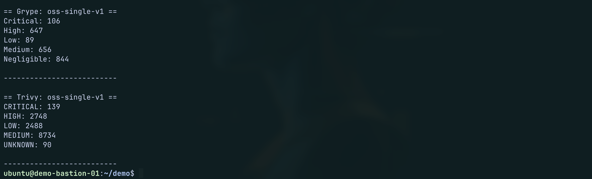

The scan is long, so we read it in three steps. The full tables are saved in [oss-single-v1-grype](/Scan-Outputs/oss-single-v1/grype.txt) and [oss-single-v1-trivy](/Scan-Outputs/oss-single-v1/trivy.txt). To read the Grype table on the server, run:

| Image | Scanner | Critical | High | Medium | Low | Other |
|:---|:---|:---|:---|:---|:---|:---|
| `hello-oss-single-v1` | Grype | 106 | 647 | 656 | 89 | 844 (Negligible) |
| `hello-oss-single-v1` | Trivy | 139 | 2,748 | 8,734 | 2,488 | 90 (Unknown) |

The same small application now has thousands of findings, and our own code did not change. Grype reports **2,342** findings and Trivy reports **14,199**. Both scanners show hundreds of Critical and High findings.

Each row in the Grype table is one finding. Look at four columns for each row: the **package**, the **installed version**, the **fixed-in version** and the **severity**. Two things stand out:

- Most rows are operating system packages (type `deb`), and not Go libraries. About nine in ten rows come from the Debian base image.
- Almost half of the rows have an empty fixed-in column. For these, no fixed version exists yet, so updating the package cannot fix them.

Trivy shows a much bigger number than Grype. The reason is the way it counts. Trivy scans every Go program inside the image, and the Go compiler and its tools are all there. Each of them is counted again with the same Go standard library bugs. This is another sign that the image carries tools our application does not need.

### Step 4.2: Group the findings by source

A big number does not tell us what to do. We need to know where the findings come from. Grype tells us the type of each package. `deb` is an operating system package. `go-module` is a Go library, and that includes the Go standard library. `binary` is a program found by its file.

```bash
jq -r '[.matches[].artifact.type] | group_by(.) | map("\(.[0]): \(length)") | .[]' reports/oss-single-v1/grype.json
```

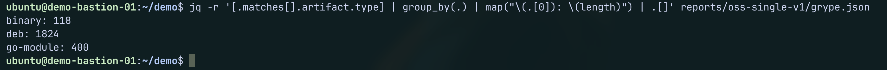

The 2,342 Grype findings split like this:

| Package type | Findings | Share |
|:---|:---|:---|
| `deb` (operating system packages) | 1,824 | 78% |
| `go-module` (Go libraries and the Go standard library) | 400 | 17% |
| `binary` (programs found by their file) | 118 | 5% |

Almost four in five findings come from the operating system of the base image. These are packages that our application never uses, but that came with the image. Only a small part comes from Go and our libraries. Write these numbers down. We use them again in Section 6 to see which part improves with a secure image.

### Step 4.3: Compare the scanners and the code check

Are the two scanners saying the same thing? Not in the totals: Grype reports 2,342 findings and Trivy reports 14,199. The scanners use different databases and different matching rules. Trivy also counts the same Go bug again for every Go program in the image. So we do not compare totals or individual IDs. We compare the severity levels and the top findings. Both scanners agree on the main point: hundreds of Critical and High findings, mostly from the base image.

Now compare with Section 2. The libraries that the code scans flagged appear again in the image scan, for example `golang.org/x/net` and `gin`. But the image scan shows much more that the code check could not see: the Go standard library inside the program, and the operating system packages of the base image, which are 78% of the Grype findings. This is why we need both: the code check early, and the image scan later.

---

## Section 5: Fix the code, the libraries and the image

Now we do what a normal team would do first: fix. Our analysis shows three things we can fix with updates: a problem in the code, the libraries in `go.mod`, and the image itself. The image has two old parts: Go 1.18, and the old base. A newer Go image fixes both, because the Go image brings its own operating system. The libraries and Go are also connected, because new libraries often need a newer Go. So we move to a new image and new libraries together.

### Step 5.1: Update the libraries

We keep the original `app` folder untouched, because we need it for the "before" results. We work in a copy, `app-fixed`. We ask Go to update all libraries to their newest versions and to clean up the `go.mod` file. We do it inside a Go container, so no Go install is needed.

The container runs two commands. `go get -u ./...` updates the libraries, and `go mod tidy` cleans up `go.mod` and `go.sum`, so they list only the libraries that the code really uses.

```bash
cp -r app app-fixed

docker run --rm --user "$(id -u):$(id -g)" -e HOME=/tmp -v "$PWD/app-fixed:/src" -w /src golang:latest \
  sh -c 'go get -u ./... && go mod tidy'
```

To see what changed, we compare the old and the new `go.mod` with the `diff` command:

```bash
diff app/go.mod app-fixed/go.mod
```

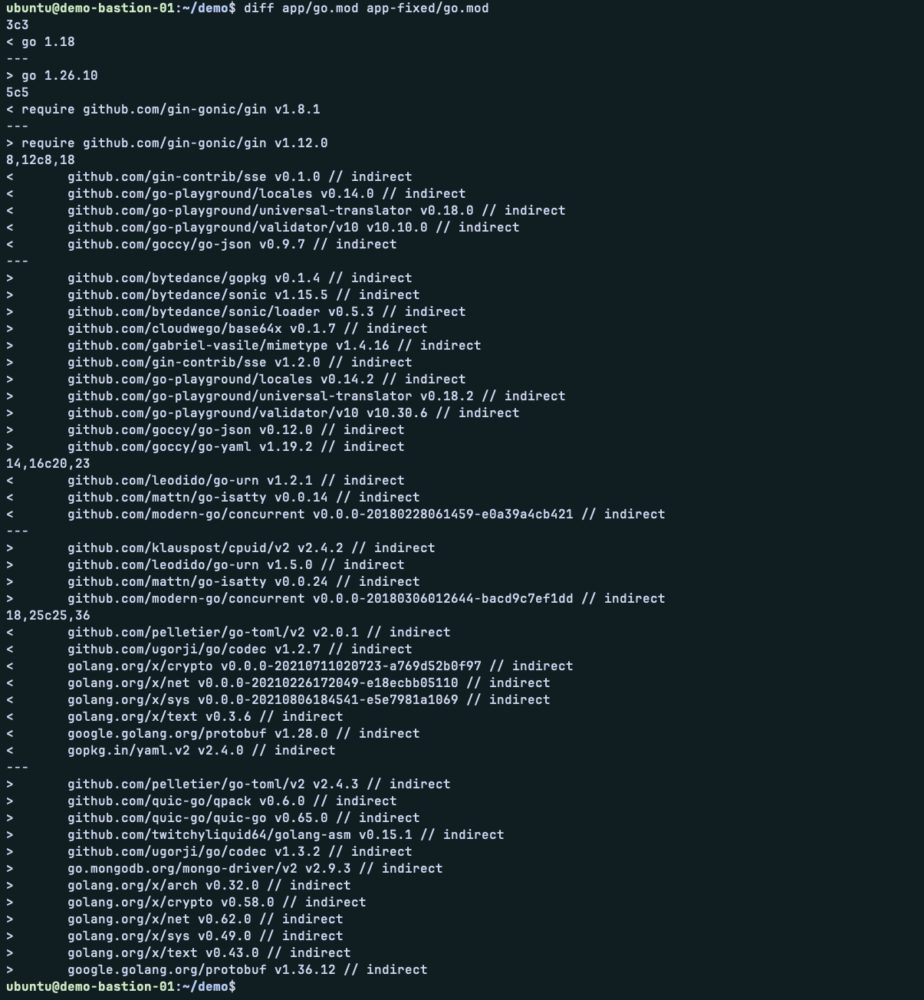

Lines that start with `<` are the old versions and lines that start with `>` are the new ones. Here is what happened. `go get -u` moved every library to its newest version, and `go mod tidy` cleaned up the file. Three changes matter:

- **Go itself moved from 1.18 to 1.26.10.** The new libraries need a newer Go, so Go raised the `go` line at the top by itself. We use this same Go version for the new image.
- **`gin` moved from v1.8.1 to v1.12.0.** This is the web framework of our application, and it is the biggest jump.
- **The libraries behind most of the findings moved past their fixed versions.** For example, `golang.org/x/net` moved from a 2021 version to v0.62.0, and `golang.org/x/text` from v0.3.6 to v0.43.0. These are the versions that Trivy and govulncheck told us to use.

You will also see some new libraries in the list. The newer `gin` depends on them, so Go added them. This is normal for a big version jump.

### Step 5.2: Fix the code

gosec found one problem in our code (G104): the program ignores the error that `r.Run()` can return. If the server fails to start, nobody would know. The fix is to check the error and log it. We replace `main.go` in the copy:

```bash
cat > app-fixed/main.go <<'EOF'
package main

import (
	"log"
	"net/http"

	"github.com/gin-gonic/gin"
)

func main() {
	r := gin.Default()
	r.GET("/", func(c *gin.Context) {
		c.String(http.StatusOK, "Hello World!")
	})
	if err := r.Run(); err != nil {
		log.Fatal(err)
	}
}
EOF
```

### Step 5.3: Run the code checks again

This is the shift-left check again. If our fixes worked, the code checks should now be clean, or much cleaner. We run the same three checks on the fixed code.

**Check the code with gosec SAST**

```bash
docker run --rm --user "$(id -u):$(id -g)" -e HOME=/tmp -v "$PWD/app-fixed:/src" -w /src golang:latest \
  sh -c 'go install github.com/securego/gosec/v2/cmd/gosec@latest && gosec ./...' \
  | tee reports/code/gosec-after.txt
```

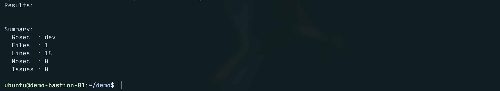

gosec now reports **0 issues**, down from `<N>` before: the unhandled error (G104) is fixed, because the program now checks and logs the error from `r.Run()`.

**Check the code with govulncheck SCA**

```bash
docker run --rm --user "$(id -u):$(id -g)" -e HOME=/tmp -v "$PWD/app-fixed:/src" -w /src golang:latest \
  sh -c 'go install golang.org/x/vuln/cmd/govulncheck@latest && govulncheck ./...' \
  | tee reports/code/govulncheck-after.txt
```

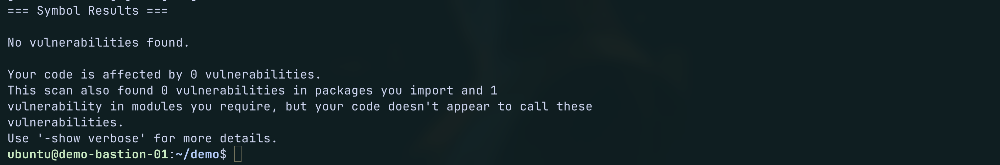

govulncheck now reports **0 vulnerabilities that our code can reach**, down from 11 before. It found 1 more vulnerability in a module we require, but our code does not call it, so it is not a risk to the application. Before, it found 63 in total (11 reachable, 8 in packages we import and 44 in modules we require).

**Check the code with tirvy SCA**

```bash
trivy fs app-fixed/ | tee reports/code/trivy-fs-after.txt
```

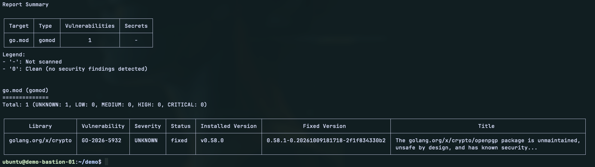

Trivy now reports **1 finding**, down from 64: `golang.org/x/crypto` (GO-2026-5932, severity UNKNOWN), a warning about the unmaintained `openpgp` package. Our code does not use it. The fix is only a pre-release version, not a normal tagged release, so we leave it and note it as the one remaining finding.

**Summary:**

| Check | Tool | Before | After |
|:---|:---|:---|:---|
| SAST | gosec | `<N>` issue(s) | **0** issues |
| SCA (reachability) | govulncheck | 63 found, **11 reachable** | 1 found, **0 reachable** |
| SCA (all libraries) | Trivy | **64** findings | **1** finding (UNKNOWN) |

The fixes worked. Our code has no issues, and no vulnerability can be reached by our application. One finding remains, in `golang.org/x/crypto` (GO-2026-5932). It is about the `openpgp` package, which our code does not use. Its fix exists only as a pre-release version, so we do not take it, and we note it as a known item.

### Step 5.4: Write the Dockerfile for the new version

We build with a pinned Go version, and not `latest`. A pinned version means we can build the same image again later. We use the same version that `golang:latest` has today, which is the one that updated `go.mod`.

It is still a single-stage build, with an open-source Go image. We change the code, the libraries and the image version. The build style does not change.

```bash
GO_VERSION=$(docker run --rm golang:latest go env GOVERSION | sed 's/^go//')

cat > Dockerfiles/Dockerfile.2-oss-single-fixed <<EOF
FROM golang:${GO_VERSION}
WORKDIR /app
COPY app-fixed/ .
RUN CGO_ENABLED=0 go build -o hello-server .
CMD ["./hello-server"]
EOF
```

### Step 5.5: Build and test

**Build the image**

```bash
docker build -f Dockerfiles/Dockerfile.2-oss-single-fixed -t hello-oss-single-v2:1.0 .
```

**Run the image**

```bash
docker run -d --name test-v2 -p 8080:8080 hello-oss-single-v2:1.0
```

**Check that it returns Hello World!**

```bash
curl -s http://localhost:8080; echo
```

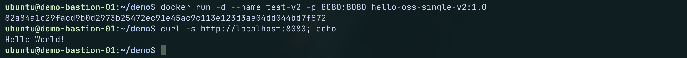

You should see `Hello World!`.

**Delete the container**

```bash
docker rm -f test-v2
```

---

## Section 6: Scan the fixed image and compare

We fixed the code, the libraries and the image. Now we scan again and compare with the first image. Think about what you expect before you look at the numbers. The library findings and the Go findings should go down a lot. The operating system findings should also go down, because the base is newer. But we do not expect zero. The base image is still a full Linux system with a compiler and many tools.

### Step 6.1: Scan the image

```bash
./scan.sh hello-oss-single-v2:1.0 oss-single-v2
```

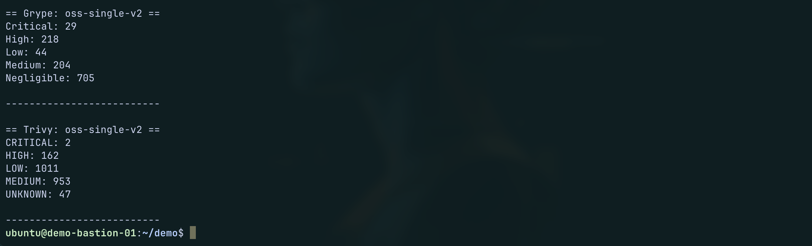

The fix helped a lot. Grype findings went from 2,342 to **1,200** (down 49%), and Critical went from 106 to **29**. Trivy findings went from 14,199 to **2,175** (down 85%), and Critical went from 139 to **2**. The Go and library findings are gone: Grype shows no `go-module` or `binary` findings now, and Trivy shows only 1 finding in our program. **All 1,200 remaining Grype findings are operating system packages** from the Debian base image, and 708 of them (59%) have no fix available.

So the part that we own is clean, and the part that we do not own is not. We can patch the OS packages that have a fix, but we cannot fix the 708 that do not, and the image still carries hundreds of tools that our application never uses.

The full tables for both scanners are in [oss-single-v2-grype](/Scan-Outputs/oss-single-v2/grype.txt) and [oss-single-v2-trivy](/Scan-Outputs/oss-single-v2/trivy.txt).

### Step 6.2: See which part improved

Because we changed several things at once, we use the type of each finding to see which part improved. We run the same command as in Step 4.2 on the new report, and compare it with the numbers from before.

```bash
jq -r '[.matches[].artifact.type] | group_by(.) | map("\(.[0]): \(length)") | .[]' reports/oss-single-v2/grype.json
```

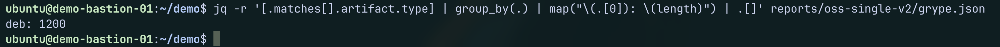

The command now prints only one line: `deb: 1200`. The `go-module` and `binary` types are missing, because no finding is left in them.

| Package type | `v1` (Step 4.2) | `v2` |
|:---|:---|:---|
| `deb` (operating system) | 1,824 | 1,200 |
| `go-module` (Go and libraries) | 400 | 0 |
| `binary` | 118 | 0 |

The fix worked exactly where we own the problem. The Go and library findings went from 518 to zero, because we updated the libraries and moved to a current Go version. The operating system findings went down by about a third, because the base image is newer. But all the findings that remain are in the operating system. This is the part of the image that we did not write and cannot fix ourselves.

### Step 6.3: Summary and comparison

| Image | Scanner | Critical | High | Medium | Low | Other | Total | Improved % |
|:---|:---|:---|:---|:---|:---|:---|:---|:---|
| `hello-oss-single-v1` | Grype | 106 | 647 | 656 | 89 | 844 (Negligible) | 2,342 | |
| `hello-oss-single-v2` | Grype | 29 | 218 | 204 | 44 | 705 (Negligible) | 1,200 | 49% |
| `hello-oss-single-v1` | Trivy | 139 | 2,748 | 8,734 | 2,488 | 90 (Unknown) | 14,199 | |
| `hello-oss-single-v2` | Trivy | 2 | 162 | 953 | 1,011 | 47 (Unknown) | 2,175 | 85% |

**What changed.** Fixing the code, the libraries and the base version cut the findings by 49% in Grype and by 85% in Trivy. The biggest drop is in the serious findings: Critical went from 106 to 29 in Grype, and from 139 to 2 in Trivy.

**What is left.** All 1,200 remaining Grype findings are operating system packages, and 708 of them (59%) have no fix available. These packages come with the base image. We did not write them and we cannot fix them ourselves. We can patch them one by one and keep patching, or we can wait for the community to publish fixes, and for the 708 findings without a fix we do not know when that will happen.

**What to think about next.** We fixed everything that we own, and the image is still not clean. So we ask a new question: **what if we start from a secure image?** A secure image from Chainguard has the same open-source software, but with far fewer vulnerabilities, and it does not depend on the community to fix them. In the next section, we build the same fixed application with a Chainguard image. We keep the same single-stage build, so only the base image changes. The difference in the scan shows how much the secure image helps.

---

## Section 7: Use a secure image (single-stage)

Now let us see what happens if we use a secure image from Chainguard. A secure image has the same open-source software, but it is rebuilt often from source, so it has far fewer vulnerabilities. It also publishes a signature and an SBOM.

We start with the same build style as before, single-stage, so the comparison with `hello-oss-single-v2` is fair. Both use the same fixed code and the same current Go. Only the base image is different.

But there is a question before we build. **Do we trust this image?** An image from outside is code that we will run. So we do not use it only because of its name. We pull it, check who built it, read what is inside, and only then build.

### Step 7.1: Pull the development image and pin it

The secure Go image has a development variant, tagged `latest-dev`. It has the compiler, a shell and the tools that are needed to build. We pull it. Then we read its digest. A digest is a unique fingerprint of the image. The tag `latest-dev` moves when a new version comes out, but a digest never changes. We use the digest in all the next steps, so we check and build on exactly the same image.

```bash
docker pull cgr.dev/chainguard/go:latest-dev
export GO_DEV_REF=$(docker inspect --format '{{index .RepoDigests 0}}' cgr.dev/chainguard/go:latest-dev)
echo $GO_DEV_REF
```

The last command prints the image name with its digest, for example `cgr.dev/chainguard/go@sha256:4cddd14c...`. We use this value in the next steps.

### Step 7.2: Check who built it: verify the signature

The images are signed. We verify the signature with Cosign. The command checks that the signature was made by the publisher's official build process on GitHub. We check the digest that we pinned.

```bash
cosign verify \
  --certificate-oidc-issuer=https://token.actions.githubusercontent.com \
  --certificate-identity=https://github.com/chainguard-images/images/.github/workflows/release.yaml@refs/heads/main \
  $GO_DEV_REF | jq
```

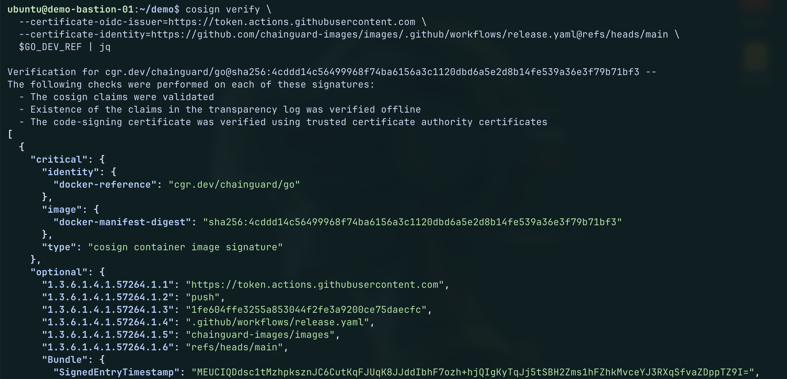

The output has three parts that matter:

- **The checks passed.** Cosign validated the signature and the certificate, and found the signature in the public transparency log.
- **The digest matches.** `docker-manifest-digest` is the same digest that we pinned, so the signature is for exactly this image.
- **Chainguard built it.** `githubWorkflowRepository` is `chainguard-images/images`, and the workflow is `release.yaml` on the `main` branch. It ran in GitHub Actions (the `Issuer` field), so the build was automatic and public. Nobody built this image by hand.

> Note: The command above pins the exact subject and issuer that we expect, so the check fails for any other signer. This is how it should be done in a real environment. If you only want to see who signed the image, without pinning them, use this command. It accepts any signer and prints the subject first and the issuer second. |*| Use this one only to find out who signed. It is not a trust check, because it would pass for any signer.

```bash
cosign verify \
  --certificate-oidc-issuer-regexp='.*' \
  --certificate-identity-regexp='.*' \
  $GO_DEV_REF | jq -r '.[].optional | .Subject, .Issuer'
```

### Step 7.3: Check what is inside: read the SBOM

The publisher also attaches an SBOM to the image. An SBOM is the list of everything that is inside it. This SBOM is also signed, so first we verify its signature. Then we download it and count the packages.

```bash
# Verify the signature of the SBOM (same signer check as for the image)
cosign verify-attestation --type https://spdx.dev/Document \
  --certificate-oidc-issuer=https://token.actions.githubusercontent.com \
  --certificate-identity=https://github.com/chainguard-images/images/.github/workflows/release.yaml@refs/heads/main \
  $GO_DEV_REF > /dev/null
```

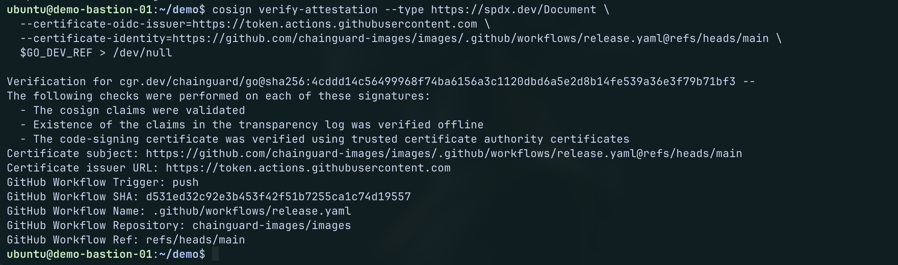

The SBOM passed the same checks as the image: it was signed by Chainguard's `release.yaml` workflow in `chainguard-images/images` on GitHub Actions, so we can trust the list of packages that we download next.

```bash
# Download the SBOM from the image and save it as a file
mkdir -p reports/base-sbom
cosign download attestation --predicate-type=https://spdx.dev/Document --platform=linux/amd64 $GO_DEV_REF \
  | head -n1 | jq -r .payload | base64 -d | jq .predicate > reports/base-sbom/go-latest-dev.spdx.json

# Count the packages that are listed in the SBOM
jq '.packages | length' reports/base-sbom/go-latest-dev.spdx.json
```

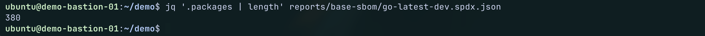

The SBOM was downloaded and saved, and it lists **380 packages** in the development image. That is expected, because this image has the compiler, a shell and the build tools. The full SBOM is in [go-latest-dev-sbom-spdx](/Scan-Outputs/base-sbom/go-latest-dev.spdx.json).

### Step 7.4: Write the Dockerfile

Now we build. The Dockerfile takes the pinned digest as a build argument. In a single-stage build, we build and run in the same image. We compile with `CGO_ENABLED=0`, so the binary is fully static.

```bash
cat > Dockerfiles/Dockerfile.3-cg-single <<'EOF'
FROM cgr.dev/chainguard/go@sha256:4cddd14c56499968f74ba6156a3c1120dbd6a5e2d8b14fe539a36e3f79b71bf3
COPY app-fixed/ /app
WORKDIR /app
RUN CGO_ENABLED=0 go build -o hello-server .
ENTRYPOINT ["/app/hello-server"]
EOF
```

### Step 7.5: Build and test

```bash
docker build -f Dockerfiles/Dockerfile.3-cg-single -t hello-cg-single:1.0 .

docker run -d --name test-cg-single -p 8080:8080 hello-cg-single:1.0

curl -s http://localhost:8080; echo

docker rm -f test-cg-single
```

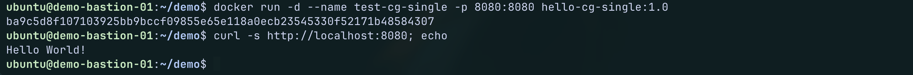

You should see `Hello World!`.

---

## Section 8: Scan the secure image and compare

### Step 8.1: Scan the image

```bash
./scan.sh hello-cg-single:1.0 cg-single
```

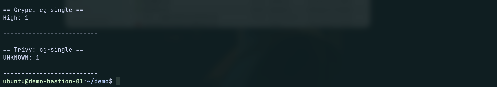

The secure image brought the findings down from **1,200 to 1** in Grype and from **2,175 to 1** in Trivy, a drop of more than 99.9%. The code, the libraries and the build are exactly the same as in `hello-oss-single-v2`. Only the base image changed, and we did not patch a single package ourselves. The full tables are in [cg-single-grype](/Scan-Outputs/cg-single/grype.txt) and [cg-single-trivy](/Scan-Outputs/cg-single/trivy.txt).

The two remaining findings are different, and each scanner sees only one of them:

- **Grype** reports one High finding in the image itself: `sqlite-libs` (CVE-2026-119586), with no fix yet. Its chance of being exploited (EPSS) is low, at 0.8%.
- **Trivy** reports no finding in the operating system at all. Its one finding is in our own program: the `golang.org/x/crypto` `openpgp` item that we already knew from Section 5 and decided to accept.

This is the value of a trusted image. We verified who built it and read its SBOM before we used it. The vendor rebuilds it often from source, so we are no longer waiting for the community to fix the 708 findings that had no fix. We start from a clean base, we know what is inside it, and what is left is a short list that we can read and explain.

### Step 8.2: See which part improved

The only change between `hello-oss-single-v2` and `hello-cg-single` is the base image. So any difference comes from the base image alone. We use the same command as in Step 4.2 and compare the types.

```bash
jq -r '[.matches[].artifact.type] | group_by(.) | map("\(.[0]): \(length)") | .[]' reports/cg-single/grype.json
```

The command prints one line: `apk: 1`. The secure image uses `apk` packages (Chainguard's own packages) instead of the `deb` packages of Debian.

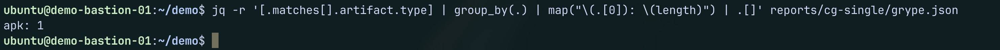

| Package type | `v1` | `v2` | `cg-single` |
|:---|:---|:---|:---|
| `deb` (Debian operating system) | 1,824 | 1,200 | 0 |
| `apk` (Chainguard operating system) | 0 | 0 | 1 |
| `go-module` (Go and libraries) | 400 | 0 | 0 |
| `binary` | 118 | 0 | 0 |

In Section 6, fixing the code and the libraries removed the Go findings, but 1,200 operating system findings stayed. Now those are gone too. Only one operating system finding is left, and nothing was fixed by us. That is the effect of the base image alone.

### Step 8.3: Summary and comparison

| Image | Scanner | Critical | High | Medium | Low | Other | Total |
|:---|:---|:---|:---|:---|:---|:---|:---|
| `hello-oss-single-v1` | Grype | 106 | 647 | 656 | 89 | 844 | 2,342 |
| `hello-oss-single-v2` | Grype | 29 | 218 | 204 | 44 | 705 | 1,200 |
| `hello-cg-single` | Grype | 0 | 1 | 0 | 0 | 0 | **1** |
| `hello-oss-single-v1` | Trivy | 139 | 2,748 | 8,734 | 2,488 | 90 | 14,199 |
| `hello-oss-single-v2` | Trivy | 2 | 162 | 953 | 1,011 | 47 | 2,175 |
| `hello-cg-single` | Trivy | 0 | 0 | 0 | 0 | 1 | **1** |

The secure image brought the findings down from **1,200 to 1** in Grype and from **2,175 to 1** in Trivy, a drop of more than 99.9%. The code, the libraries and the build are exactly the same as in `hello-oss-single-v2`.

The two remaining findings are different, and each scanner sees only one of them. Grype reports one High finding in the image itself: `sqlite-libs` (CVE-2026-119586), with no fix yet and a low chance of being exploited (EPSS 0.8%). Trivy reports no finding in the operating system. Its one finding is the `golang.org/x/crypto` `openpgp` item in our own program, which we already knew from Section 5.

This is the value of a trusted image. We verified who built it and read its SBOM before we used it. The vendor rebuilds it often from source, so we are no longer waiting for the community to fix the 708 findings that had no fix. We start from a clean base, we know what is inside it, and what is left is a short list that we can read and explain.

But this image is still a single-stage image. It carries the Go compiler and the development tools, so it still has a larger attack surface than it needs, even if it is clean. Now we ask the next question: **the application does not need a compiler to run. Why do we ship it?** This is the reason for the next section.

---

## Section 9: Use a multi-stage build (development image to build, distroless image to run)

Now let us see what happens if we reduce the attack surface by using a multi-stage build. The idea is to use two different images for two different jobs.

* The **build stage** uses the secure development image. It has more packages: a shell, a compiler and the tools we need to build. It builds our application. We already checked it in Section 7.
* The **run stage** uses a secure **distroless** image. It has almost nothing in it. No shell, no package manager, no compiler. We copy only the finished application into it, and we change nothing else.

The distroless image is called `static`. It works for our program, because our program is a static binary. We compiled it with `CGO_ENABLED=0`, so it needs no other library.

### Step 9.1: Pull the distroless image and pin it

We pull the image and pin it by its digest, as we did for the development image.

```bash
docker pull cgr.dev/chainguard/static:latest
export STATIC_REF=$(docker inspect --format '{{index .RepoDigests 0}}' cgr.dev/chainguard/static:latest)
echo $STATIC_REF
```

> In this section we skip the signature and SBOM checks, to keep it short. We did them for the development image in Section 7. In a real environment, they must be done for every image that we use, including this one.

### Step 9.2: Write the Dockerfile

The first stage is the development image. The second stage is the distroless image. The line `COPY --from=builder` takes only our finished application from the first stage.

```bash
cat > Dockerfiles/Dockerfile.4-cg-multi <<'EOF'
FROM cgr.dev/chainguard/go@sha256:4cddd14c56499968f74ba6156a3c1120dbd6a5e2d8b14fe539a36e3f79b71bf3 AS builder
COPY app-fixed/ /app
WORKDIR /app
RUN CGO_ENABLED=0 go build -o hello-server .

FROM cgr.dev/chainguard/static@sha256:fc42af33e643f20d08baf03cddcc1c02ba57052dfb02edb0d79f3fc47bcea8d9
COPY --from=builder /app/hello-server /usr/bin/hello-server
ENTRYPOINT ["/usr/bin/hello-server"]
EOF
```

### Step 9.3: Build and test

```bash
docker build -f Dockerfiles/Dockerfile.4-cg-multi -t hello-cg-multi:1.0 .

docker run -d --name test-cg-multi -p 8080:8080 hello-cg-multi:1.0

curl -s http://localhost:8080; echo

docker rm -f test-cg-multi
```

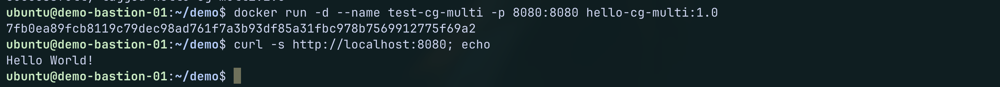

You should see `Hello World!`.

---

## Section 10: Scan the multi-stage image and compare everything

### Step 10.1: Scan the image

```bash
./scan.sh hello-cg-multi:1.0 cg-multi
```

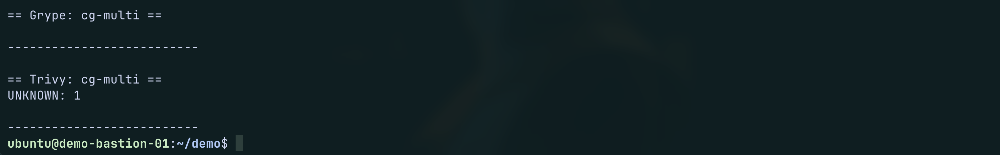

Only the build style changed between `hello-cg-single` and `hello-cg-multi`, and the findings went from 1 to **0** in Grype. Trivy still reports 1, the `golang.org/x/crypto` item in our own program. The full tables are in `Scan-Outputs/cg-multi/grype.txt` and `Scan-Outputs/cg-multi/trivy.txt`.

### Step 10.2: See which part improved

The only change between `hello-cg-single` and `hello-cg-multi` is the build style. So any difference comes from the build style alone. We use the same command as in Step 4.2 and compare the types.

```bash
jq -r '[.matches[].artifact.type] | group_by(.) | map("\(.[0]): \(length)") | .[]' reports/cg-multi/grype.json
```

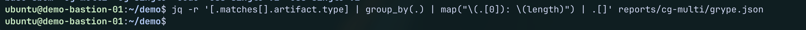

The command prints nothing. This is the result we want: Grype found no vulnerability, so there is no package type to count. The full output is in `Scan-Outputs/cg-multi/grype.txt` and `Scan-Outputs/cg-multi/trivy.txt`.

| Package type | `v1` | `v2` | `cg-single` | `cg-multi` |
|:---|:---|:---|:---|:---|
| `deb` (Debian operating system) | 1,824 | 1,200 | 0 | 0 |
| `apk` (Chainguard operating system) | 0 | 0 | 1 | 0 |
| `go-module` (Go and libraries) | 400 | 0 | 0 | 0 |
| `binary` | 118 | 0 | 0 | 0 |

In Section 8, the secure base image removed the operating system findings, but one finding was left in `sqlite-libs`, a package that came with the development tools. That finding is gone now. The multi-stage build ships only the finished program in the small runtime image, so the development tools, and the vulnerability that came with them, are not in the final image. Grype reports **0** findings. Trivy reports **1**: the `golang.org/x/crypto` `openpgp` item, which is in our own program and which we accepted in Section 5.

### Step 10.3: Summary and comparison

| Image | Scanner | Critical | High | Medium | Low | Other | Total |
|:---|:---|:---|:---|:---|:---|:---|:---|
| `hello-oss-single-v1` | Grype | 106 | 647 | 656 | 89 | 844 | 2,342 |
| `hello-oss-single-v2` | Grype | 29 | 218 | 204 | 44 | 705 | 1,200 |
| `hello-cg-single` | Grype | 0 | 1 | 0 | 0 | 0 | 1 |
| `hello-cg-multi` | Grype | 0 | 0 | 0 | 0 | 0 | **0** |
| `hello-oss-single-v1` | Trivy | 139 | 2,748 | 8,734 | 2,488 | 90 | 14,199 |
| `hello-oss-single-v2` | Trivy | 2 | 162 | 953 | 1,011 | 47 | 2,175 |
| `hello-cg-single` | Trivy | 0 | 0 | 0 | 0 | 1 | 1 |
| `hello-cg-multi` | Trivy | 0 | 0 | 0 | 0 | 1 | **1** |

The same application, with the same logic, went from **2,342 findings to 0** in Grype and from **14,199 to 1** in Trivy. Each step did a different job:

- **Fixing what we own** (code and libraries) removed all the Go and library findings, 518 in Grype. This is the cheapest step, but it left 1,200 operating system findings that we could not fix.
- **Using a secure image** removed almost all of those 1,200 at once, without us patching a single package. We checked who built the image and what is inside it, and we do not wait for the community to fix the findings.
- **Using a multi-stage build** removed the last finding in the image, and it removed the compiler and the build tools. The final image has only the program and what it needs to run.

One finding remains in Trivy: the `golang.org/x/crypto` `openpgp` item, in our own program. Its fix exists only as a pre-release version, and our code does not use that package, so we accept it for now and write it down. The point is not zero findings. The point is that what is left is a short list that we can read, explain and decide on.

---

